# Ori

<p align="center"></p>

Ori is Orbit's mascot: a soft eight-point star, the sun the workspaces orbit,
with a lavender ring, a peach moon on it and two floating mitten hands. Ori is
how Orbit shows what Claude is doing, keeps empty places from feeling empty,
and explains the app when you ask.

## The poses

| | Pose | Shows when | Moves |
| --- | --- | --- | --- |
|  | `idle` | a workspace is ready | floats, blinks |
|  | `hi` | the first screen, a new workspace, the README | waves |
|  | `thinking` | Claude is thinking before it acts | looks up, thought dots pulse |
|  | `working` | a shell command runs, Claude writes its answer | types on a laptop |
|  | `reading` | reading or searching files, reading a doc | peers through a magnifying glass |
|  | `searching` | web search, fetching a page | looks through a telescope |
|  | `writing` | writing or editing files and docs | scribbles with a pencil |
|  | `planning` | updating the plan | holds a checklist |
|  | `drawing` | working on the whiteboard | holds up a sticky note |
|  | `camera` | screenshots and the preview | takes a picture, the flash pops |
|  | `needs` | an approval is waiting | hops and waves a peach flag |
|  | `done` | a run finished | arms up, sparkles |
|  | `sleeping` | a workspace has been quiet for half an hour | breathes, z's drift up |
|  | `oops` | an error stopped the run | a small shake, a sweat drop |
|  | `helpers` | helpers are working for the workspace | little stars ride the ring |

Below 34 pixels Ori keeps only the star and a bigger face; the ring and hands
would only blur. The browser tab uses that small Ori, with a peach dot when
something needs you and a lavender one while Claude works.

## Where Ori is

- **The workspace header**: the pose for what Claude is doing right now, with
  what it is doing in the tooltip.
- **The setup wizard**: hi, reading (your key), thinking (how you like to
  work), needs (who approves), done.
- **Ask Ori**: the button at the bottom left of the sky and of a workspace,
  or the <kbd>?</kbd> key. Topics: reading the sky, how Claude asks first, ways
  of working, helpers, preview and docs and the board, missions, shortcuts,
  and running the setup again.
- **Tours**: a spotlight walk around the sky or a workspace. Each is offered
  once, the first time you're there, and is always in Ask Ori.
- **Toasts**: done for good news, thinking for a warning, oops for an error.
- **Empty places**: an empty workspace, no docs, an empty board, nothing in
  the preview, nothing to review.
- **Approvals**: the line above the question.

## Using Ori in code

```tsx
import { Ori } from "./components/ori/Ori";

<Ori pose="working" size={64} />          // moves
<Ori pose="needs" size={30} still />      // holds still
```

`size` is in pixels; Ori is drawn on a 400 unit square. Every animation is CSS
in `web/src/components/ori/ori.css` and stops under reduced motion, under
Settings, Interface, Motion: Off, and with `still`. `poseForTool()` in
`web/src/lib/ori.ts` maps a tool to its pose.

Every pose at a few sizes is at `#/ori` in a running Orbit. The SVG files in
`docs/images/ori` are drawn from the same component:

```sh
bun scripts/ori-svgs.ts
```

## Drawing rules

- The star is cream (`#FFE6AE`), shaded on the lower right as if lit from the
  upper left. The ring is lavender, its moon peach: Orbit's two colours.
- The face is two dots and a small mouth. Expressions change the eyes and
  the mouth only.
- Hands float; they are never attached. Hands in front of the star get a
  thin warm edge so they don't disappear into it.
- Every pose has exactly two hands. Things Ori holds bring their own hands.
- Ori moves slowly, and only in loops that say something.
