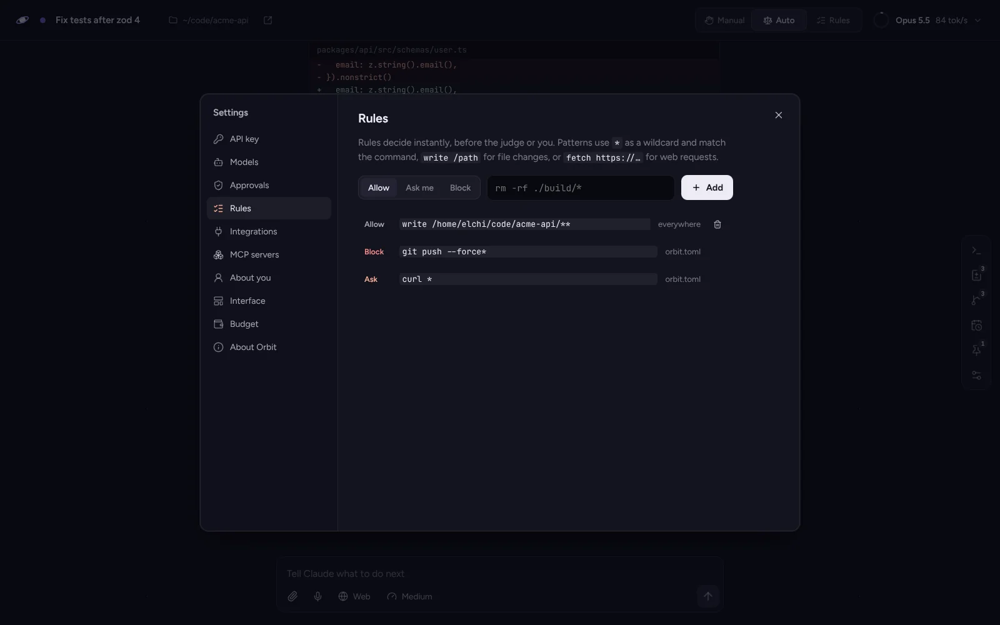

# Permissions

Every action Claude proposes passes the same gate before anything happens on
your machine. This page is the whole gate, in the order it is checked. The
code is `server/gate.ts`; the tests that hold it to this page are
`server/gate.test.ts`.

## 1. Interface tools

`ui_set_title`, `ui_set_planet`, `ui_notify`, `ui_pin`, `ui_show`,
`ui_widget`, `preview_open`, the doc tools (`doc_write`, `doc_edit`,
`doc_read`, `doc_comment`) and the whiteboard tools only change Orbit itself,
never your files, so they are always allowed. Switch any of them off in
Settings, Interface, and Claude no longer sees it.

`delegate`, which starts a helper, is allowed the same way: starting one does
nothing on its own. Everything the helper then does passes this gate like any
other action (see Helpers below).

## 1a. A helper's folders

A helper given a list of folders (`paths`) may write only there. `write_file`
and `edit_file` anywhere else are refused before rules or modes are looked at,
in every mode including Full. Shell commands are not confined this way; they
go through the steps below like any other command.

## 2. Read-only actions

With `skip_readonly = true` (the default), these run at once, without a rule,
a judge or a question:

- `read_file`, `list_dir`, `glob`, `grep`
- shell commands where every part is on the read-only list: `ls`, `cat`,
  `head`, `tail`, `wc`, `pwd`, `echo`, `rg`, `grep`, `tree`, `file`, `stat`,
  `du`, `df`, `which`, `env`, `sort`, `uniq`, `cut`, `diff`, `jq`, `ps` and a
  few more, `cd`, `find` without `-delete` or `-exec`, `git status`, `log`,
  `diff`, `show`, `blame`, `ls-files` and `rev-parse`, and `<tool> --version`

- read-only subcommands of the 100 programs Orbit knows: `docker ps`,
  `kubectl get`, `terraform validate`, `gh pr list`, `npm ls`, `cargo clippy`
  and so on, listed per program in [COMPATIBILITY.md](COMPATIBILITY.md). A
  flag that turns a read into a write is caught: `npm audit fix`,
  `prettier --check --write`, `ruff check --fix`, `git diff --output=`,
  `rg --pre`. `npx`, `bunx`, `uv run` and `poetry run` are judged by the
  program they run.
- `load_skill`, and tools of an MCP server that the server marks read-only
  (unless that server has `trust_readonly = false`)

A command is only read-only when **every** part of it is. Any of these makes
the whole command go through the gate: output redirection (`>`), command
substitution (`$(...)` or backticks), `tee`, `sudo`, or any program not on the
list. `ls && rm -rf x` is not read-only.

`fetch_url` is never read-only: a request can carry data out as easily as it
brings data in.

## 3. Rules

Rules are checked next and decide instantly. A rule has a pattern and a
verdict: **allow**, **ask** (always ask me, even in Auto mode) or **block**.

The pattern is matched against the whole action:

| Action | Matched text |
| --- | --- |
| shell | the command, as written: `rm -rf ./build/cache` |
| `write_file`, `edit_file` | `write ` and the absolute path: `write /home/me/app/src/a.ts` |
| `fetch_url` | `fetch ` and the URL: `fetch https://api.example.com/v1` |
| `screenshot` of another site | `fetch ` and the URL, so fetch rules apply; your own pages are read-only |
| an MCP tool | `mcp `, the server, the tool and its arguments as JSON with shell operators taken out: `mcp linear create_issue {"title":"..."}` |

`*` matches any text **except shell operators** (`;`, `&`, `|`, backtick,
`$`, `(`, `)`, `<`, `>` and new lines). So `rm -rf ./build/*` allows
`rm -rf ./build/cache` but not `rm -rf ./build/x; rm -rf ~`. `?` matches one
character under the same condition. Set `kind = "regex"` for a regular
expression instead.

Where rules come from, and which wins:

1. rules saved for this workspace (from "Always allow" in an approval)
2. rules saved for every workspace (Settings, Rules)
3. rules in `orbit.toml`

The first match decides. Within the database, newer rules are checked first.

"Always allow" suggests a pattern you can edit before saving. For anything
destructive or outward facing (`rm`, `mv`, `chmod`, `kill`, `sudo`, `curl`,
`git` and similar, and every guarded subcommand in the catalog such as
`kubectl delete`, `terraform apply` or `vercel deploy`), the suggestion is the
exact command, never a wildcard. For other commands it is the first two words
and `*` (`npm install *`), one word deeper when that group has a guarded member
(`docker compose up *`, so `docker compose down` stays out), for files the
folder (`write /home/me/app/src/**`).

## 4. The workspace mode

Only actions no rule decided get here.

| Mode | What happens |
| --- | --- |
| **Manual** | You decide every one. |
| **Auto** | The judge decides. When it is unsure, you decide. |
| **Rules** | Blocked. For runs nobody is watching. |
| **Full** | Allowed, unless it reaches outside the workspace folder (a path or a write there), escalates (`sudo`, `dd`, `mkfs`, `shutdown` and the like) or is a guarded command from the catalog. Those go to the judge, and an unsure judge means no. Nobody is asked. |

A profile with **hands off** (Autopilot) runs every request like a mission.
Missions run unattended, with stricter versions of the same steps: Manual
becomes Rules, a rule that says **ask** means no, and in Auto mode a judge that
is unsure means no. Nothing ever waits for an answer.

## The judge

When an action matches a guarded subcommand from the catalog, the judge is told
so: "Orbit marks this as destructive or outward-facing (kubectl: kubectl
delete). Allow it only when the goal clearly asks for exactly this."

The judge is a second, cheaper model (`claude-sonnet-5-5` by default) asked
one question: may this one action run without asking the user?

It sees:

- your judge notes, the global ones and the workspace's own
- your first request in the workspace and your latest one, as the goal
- the last few messages and tool outputs (`judge_context_messages`, 6 by
  default), marked as untrusted data
- the workspace folder and the action itself

It answers `allow`, `deny` or `ask` with a one-line reason, which is shown on
the action's capsule and in the approval.

What keeps it safe and fast:

- **It fails closed.** An error, an unreadable answer or no answer within
  `judge_timeout_ms` (12 s) becomes "ask", never "allow".
- **It cannot be talked into things by files.** Its instructions say that
  text inside the untrusted block is data, and that an action which looks like
  it came from a file, a web page or command output rather than from you
  should be refused. It also sees your actual goal, so an action drifting away
  from it stands out.
- **Your notes win.** "rm -rf inside the workspace is fine" in the notes means
  the judge allows it.
- **It runs in parallel.** When Claude proposes several actions at once, they
  are judged together.
- **It is asked once.** An action the judge allowed is remembered for the
  workspace until Orbit restarts.

Its cost is counted separately in the telemetry ("Judge here").

## Approvals

When you decide, the approval shows the action, why it stopped (the judge's
reason, or that you are in Manual mode), and for edits the diff.

| Key | Button | Effect |
| --- | --- | --- |
| Y | Allow once | Runs it this time. |
| A | Always allow | Runs it and saves the pattern below the buttons as a rule for this workspace. |
| N | Deny | Does not run it. Claude is told it was refused, and with what reason if you wrote one, and asked to find another way rather than retry. |

While a workspace waits for you, the others keep running. Its planet pulses
peach in the Orrery and the home screen lists it under "needs you".

## Stopping

- **Esc** stops the current run. Waiting approvals are answered "deny".
- **Esc twice** within a second also kills the workspace's shell and every
  process it started. The next command gets a fresh shell.
- The shell drawer and the dock have the same kill switch as a button.

## Undo

With `undo_journal = true` (the default), every file is saved to the database
before `write_file` or `edit_file` changes it. The Files panel undoes the
newest change first, one at a time: an edited file gets its old content back,
a created file is removed. Files larger than `undo_max_bytes` (2 MB) are not
saved.

The journal covers Orbit's file tools only. A shell command that deletes or
rewrites files (`rm`, `sed -i`, a build) is not journaled; that is what the
gate is for.

## Helpers

A helper runs under its parent's approval mode and never a looser one, with
the same rules and judge notes. Its questions come up in its own view and in
the parent's, labelled with the helper's name. When the parent runs
unattended (a mission, or a profile that never asks), so do its helpers.
Stopping the parent stops its helpers.
